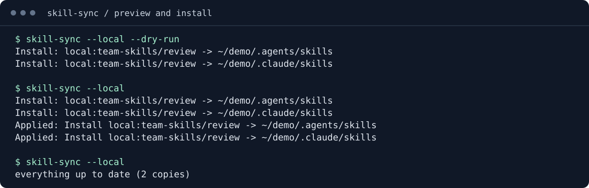
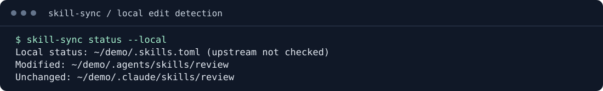

# skill-sync

Keep your AI agents on the skills you chose, without losing track of local changes.

You add a skill to Codex, copy it to Claude Code, and add a project-specific version for Cursor. Updating the source now means checking several directories. An edited copy is easy to overwrite; a removed skill is easy to leave behind.

skill-sync puts those installation choices in a TOML manifest. Run one command to install, update and remove the copies it owns. Each destination has its own recorded state. Local edits stop replacement, and a failed destination can be retried independently.

It installs [Agent Skills](https://agentskills.io/specification) into the directories your agents already read. It uses independent copies, so editing one installation does not change another.

## In the terminal

<!-- screenshots:start -->
### Preview and install



### Detect local edits


<!-- screenshots:end -->

## Install

Prebuilt releases support **macOS Apple Silicon** and **Linux x86_64**. You need Git for syncing remote sources; you do not need Node.js or a Rust toolchain to run the binary.

Download the installer and install the latest release:

```sh
curl -fsSL https://raw.githubusercontent.com/benvds/skill-sync/main/install.sh -o install-skill-sync.sh
sh install-skill-sync.sh
```

The installer verifies the archive's SHA-256 checksum before replacing an existing binary. It installs to `~/.local/bin`; add that directory to your `PATH` if needed.

Choose a release or installation directory:

```sh
sh install-skill-sync.sh --version v1.0.0 --install-dir "$HOME/.local/bin"
# Environment alternatives: SKILL_SYNC_VERSION and INSTALL_DIR
```

Use the exact tag of a published release. The installer requires the archive and its `.sha256` sidecar, produced by the release workflow; older releases without checksums cannot use this installer. Checksums detect corrupted downloads, not a compromised release publisher.

Build from a checkout with Rust 1.89 or newer:

```sh
cargo install --locked --path .
```

## Put your personal setup in one file

```sh
skill-sync --global --init
```

Edit `~/.config/skill-sync/skills.toml` (`$XDG_CONFIG_HOME` is honored):

```toml
[sync]
scope = "user"
agents = ["codex", "claude-code", "cursor"]

[skills]
repos = [
    "anthropics/skills/skills/skill-creator",
    # "your-org/team-skills/skills/review@v1.2.3",
]
```

Preview, sync, then inspect the installed files:

```sh
skill-sync --global --dry-run
skill-sync --global
skill-sync status --global
```

The preview exits with code `2` when changes are pending. It fetches sources to validate the plan, but does not change installations. `status` runs offline and checks local files against recorded hashes.

## Give a project its own skills

Create `.skills.toml` in your project and commit it:

```toml
[sync]
scope = "project"
agents = ["codex", "claude-code"]

[skills]
repos = ["github/awesome-copilot/skills/github-issues"]
```

```sh
skill-sync --local --dry-run
skill-sync --local
```

Project skills stay inside the project. Your personal skills stay in your home directory. Running `skill-sync` without a scope flag processes your central manifest and the nearest project manifest, each with its own settings and lock.

## See what needs attention

```sh
skill-sync status --local       # Also available as: skill-sync doctor --local
skill-sync status --json        # Offline local snapshot
skill-sync --dry-run --json     # Upstream-aware plan
skill-sync --local --force --json
```

Local status shows missing, modified, unverified and unmanaged copies, plus sources that need a first sync. It does not check remote updates or changed branch/tag contents. JSON output includes a schema version, exit code, errors and per-operation outcomes, including partial failures.

`--force` accepts bulk-install and removal confirmations. Local edits and unmanaged collisions still block replacement. Moving your edited copy to a backup lets sync restore the upstream version.

## Know what sync will change

- **Install:** a repository, an exact skill path, or a collection of descendant skills. Add `@tag`, `@branch` or `@commit` to select a revision.
- **Update:** replace owned, unmodified copies. Full commit SHAs are durable pins; branches and tags are resolved again on each sync.
- **Remove:** reconcile sources or destinations removed from the manifest, after confirmation. Unmanaged files remain outside its ownership.
- **Recover:** retain successful targets and restore previous files after ordinary copy or state-write failures. Rerun to retry missing work.

The `.skills.lock` file records installed state. Use `skill-sync lock --local` and commit `.skills.sources.lock` for `--frozen` installation. Installing 10 or more new distinct skills requires confirmation. Sync plans all selected manifests before changing targets, and prevents concurrent CLI writers using the same manifest or target. Coordination files are kept under `~/.cache/skill-sync/run-locks`; OS locks release automatically after exit or a crash.

Supported agent destinations include Codex, Claude Code, Cursor, Gemini CLI, Copilot, OpenCode, Goose and Kiro. You can override native paths. Sync copies files without executing bundled scripts; the agent determines how installed skills are used.

## Manage sources from the terminal

```sh
skill-sync add 'local:../private-skills' --local --dry-run
skill-sync add 'local:../private-skills' --local --agent codex,claude-code
skill-sync add 'git+ssh://git@git.example.com/team/skills.git//review#v1' --local
skill-sync --local --diff
skill-sync lock --local
skill-sync --local --frozen
skill-sync update --local --dry-run
skill-sync remove 'local:../private-skills' --local
```

Add/remove preserve manifest comments and leave installation to the usual preview/sync flow. Local paths resolve relative to the manifest. Git sources support HTTPS and SSH with your Git credentials. A bounded repository cache speeds repeated previews and lets frozen installations reuse cached commits offline. `--diff` previews upstream and local file changes against retained baselines. Additional tools can use named custom agent destinations. See the [source-management reference](docs/reference.md#pre-v2-source-management) for syntax, locks, cache limits and examples.

## Start with a preview

Create your manifest, choose the agents you use, and run `skill-sync --dry-run`. The plan shows which copies will change before you apply it.

- [Configuration and CLI reference](docs/reference.md): source syntax, exact paths, status states, JSON schema, exit codes, authentication and recovery.
- [Example manifests](examples/): personal, project and collection setups.
- [Product requirements](docs/PRD.md): scope and acceptance criteria.
- [Roadmap](docs/ROADMAP.md): terminal management in v1, public-index browsing in v2, and an egui desktop app in v3.

The package is currently `1.0.0`. The roadmap's v1, v2 and v3 describe planned product milestones; the browser and GUI are not implemented.

## Develop

```sh
cargo fmt --all --check
cargo test --locked
cargo clippy --locked --all-targets -- -D warnings
python3 -m unittest discover -s tests -p 'test_*.py' -v
python3 scripts/release.py --check
python3 scripts/screenshots.py --check
```

CI checks macOS and Linux, with a separate minimum-Rust check. Source tests use local Git and HTTP fixtures. Optional public-GitHub smoke tests are described in the [reference](docs/reference.md#examples-and-development).

### Refresh README screenshots

```sh
python3 scripts/screenshots.py
```

This builds the current CLI and captures preview, installation and local-edit status from a temporary project with local skill fixtures. It writes SVG terminal screenshots to `docs/screenshots/` and updates the marked README gallery. Captures use an isolated home, require no network, and replace temporary paths with `~/demo`. Commit the images with CLI output changes; CI uses `--check` to detect stale captures. Python 3.9 or newer is required for the development scripts.

### Release a version

Start from a clean branch containing the latest `origin/main` commits:

```sh
git fetch origin
git merge --ff-only origin/main
python3 scripts/release.py patch --dry-run
python3 scripts/release.py patch
# Or select minor, major, or an explicit version such as 0.2.0.
```

The release script updates `Cargo.toml`, this package's `Cargo.lock` entry, and current-version references in the README, PRD and roadmap. The CLI version and HTTP user agents already read Cargo's package version. It refreshes screenshots, runs formatting, Rust tests, Clippy and Python regression checks, then commits the release and creates an annotated `vX.Y.Z` tag. It refuses existing tags and uncommitted changes. A failed check leaves the bumped files for review without creating a commit or tag. Product milestones and dependency versions are independent of the package version.

Push the branch and tag using the command printed by the script, or pass `--push` to publish them atomically to `origin`. Pushing the tag triggers the existing macOS/Linux release workflow, which gates publication on CI, package checks and installer smoke tests. Without `--push`, everything stays local. CI also checks version consistency with `python3 scripts/release.py --check` and verifies that release tags match the package.
